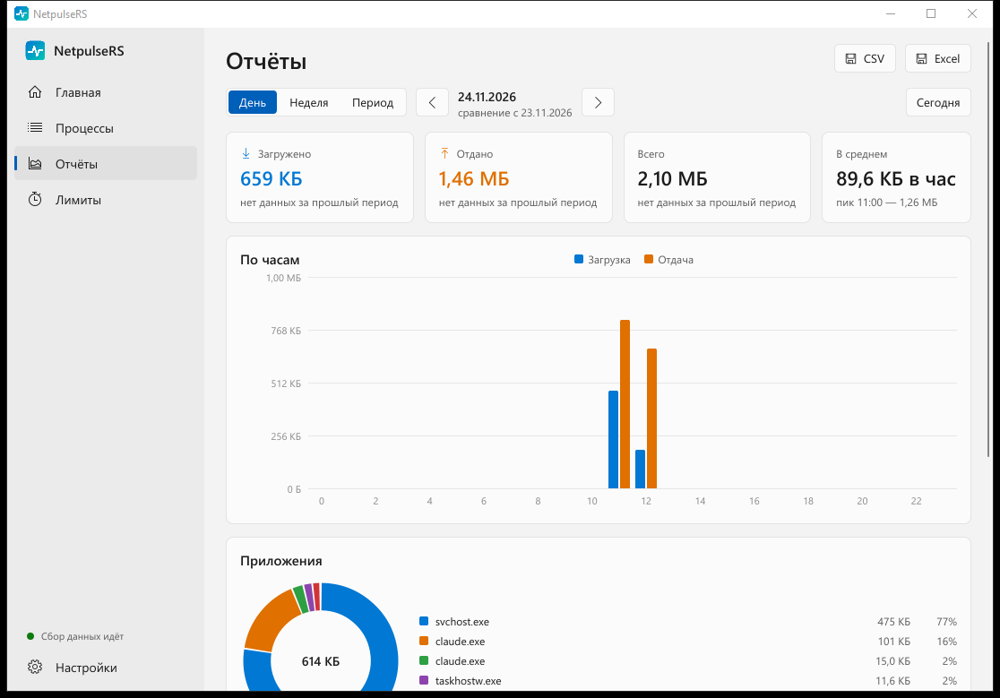
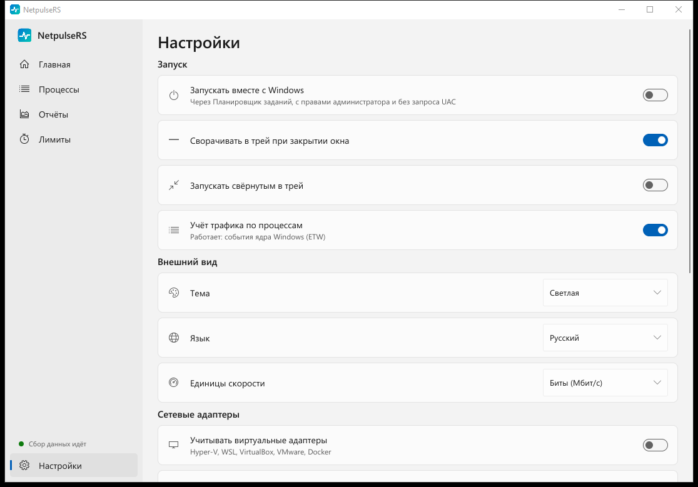
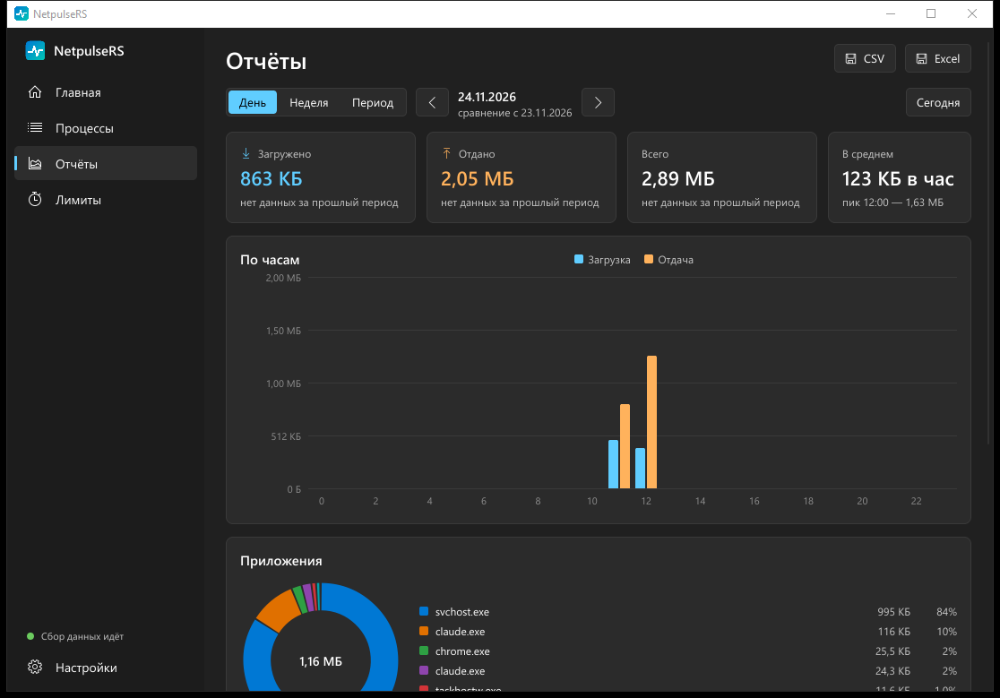
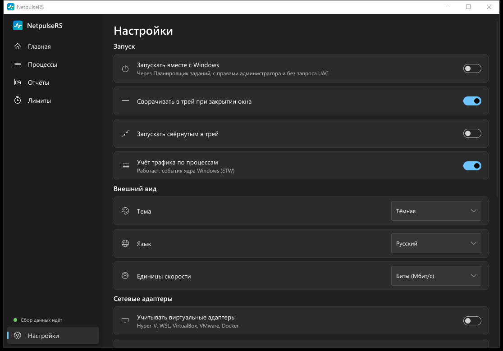

<p align="center">
  
</p>

<h1 align="center">NetpulseRS</h1>

<p align="center">
  Монитор сетевого трафика для Windows 10/11 в стиле Fluent.<br>
  Один exe ~9 МБ, без .NET и установки, ~30 МБ памяти. Написан на <b>Rust + Slint</b>.
</p>

<p align="center">
  <a href="https://github.com/fullspb/NetpulseGUI/releases/latest"></a>
  
  
</p>


## Возможности

- **Скорость в реальном времени** — загрузка и отдача, пики, график за 1 минуту / 5 минут / 1 час с подсказкой по наведению.
- **Трафик по приложениям** — через события ядра Windows (ETW): TCP и UDP, IPv4 и IPv6. Скорость сейчас, объём за сегодня, доля в %, поиск, карточка приложения с графиками по часам и за 30 дней.
- **Отчёты** — день, неделя, расчётный период; сравнение с прошлым периодом, среднее и пик, диаграмма по приложениям, экспорт в **CSV** и **Excel**.
- **Лимиты** — дневной и на расчётный период (с любого дня месяца, как у провайдера), прогноз к концу периода, уведомления на 80 / 90 / 100 %.
- **Трей** — значок с текущей скоростью (↓ сверху, ↑ снизу), меню, сворачивание в трей.
- **Адаптеры** — учитываются те же, что видны в «Панели управления»; виртуальные (Hyper-V, WSL, VirtualBox…) и VPN — по желанию.
- Автозапуск через Планировщик заданий (с правами администратора, без запроса UAC), светлая и тёмная тема, русский и английский.

## Скриншоты

| | |
|---|---|
|  |  |
|  |  |
|  |  |

## Скачать

Последняя версия — на странице [Releases](https://github.com/fullspb/NetpulseGUI/releases/latest):

| Файл | Что это |
|---|---|
| `NetpulseRS.exe` | Программа целиком, ~9 МБ. Просто запустите |
| `NetpulseRS.zip` | То же в архиве, ~5 МБ |

Программе нужны права администратора: без них Windows не отдаёт трафик отдельных приложений. Статистика и настройки хранятся в `%LOCALAPPDATA%\NetpulseRS`.

Ключи запуска: `--minimized` — сразу в трей, `--shutdown` — корректно завершить запущенную копию.

## Сборка

Нужны Rust (`x86_64-pc-windows-gnu`) и MinGW-w64; Visual Studio не нужна.

```powershell
winget install Rustlang.Rustup
rustup default stable-x86_64-pc-windows-gnu
winget install BrechtSanders.WinLibs.POSIX.UCRT
.\build.ps1
```

Результат — `dist\NetpulseRS.exe` и `dist\NetpulseRS.zip`.

## Как устроено

| Файл | Что делает |
|---|---|
| `src/adapters.rs` | 64-битные счётчики (GetIfTable2), список адаптеров, видимость как в «Панели управления» |
| `src/etw.rs` | ядерная ETW-сессия на Win32 API: трафик по процессам |
| `src/store.rs` | хранилище без SQLite: минуты (48 ч), часы и дни в памяти; снимок + журнал на диске |
| `src/collector.rs` | фоновый сбор раз в секунду |
| `src/tray.rs` | значок в трее (рисуется через GDI), меню, уведомления |
| `src/export.rs` | CSV и xlsx (собирается вручную) |
| `ui/*.slint` | интерфейс; графики — элементы `Path`, пути строятся в Rust |
| `lang/en/…/netpulse-rs.po` | английский перевод, встраивается в exe |

## История

До версии 2.0 программа называлась **NetpulseGUI** и была написана на C# / WPF / .NET 9 (79 МБ со встроенным .NET, ~280 МБ памяти). Её код остался в истории репозитория. Версия 2.0 — полный переход на Rust: размер меньше в 8 раз, память — в 9 раз.

Статистика NetpulseGUI в NetpulseRS не переносится.
