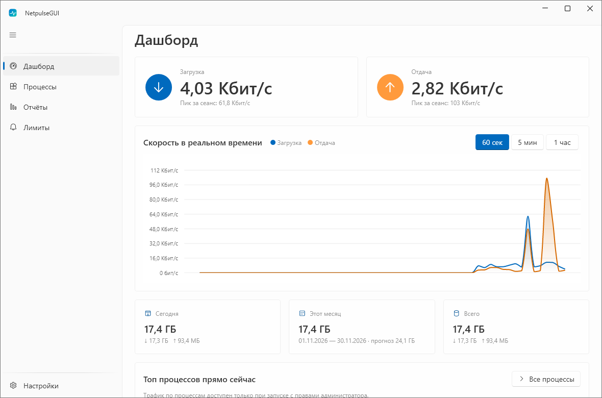
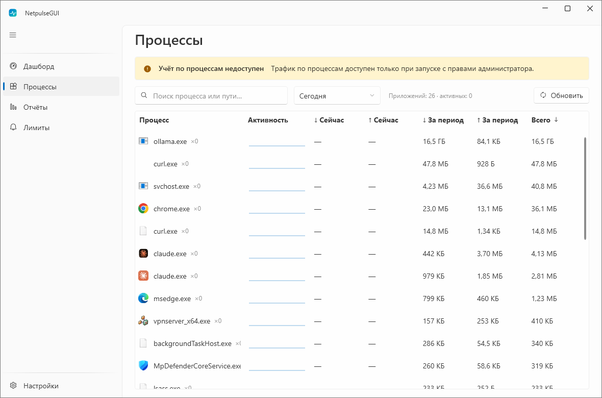
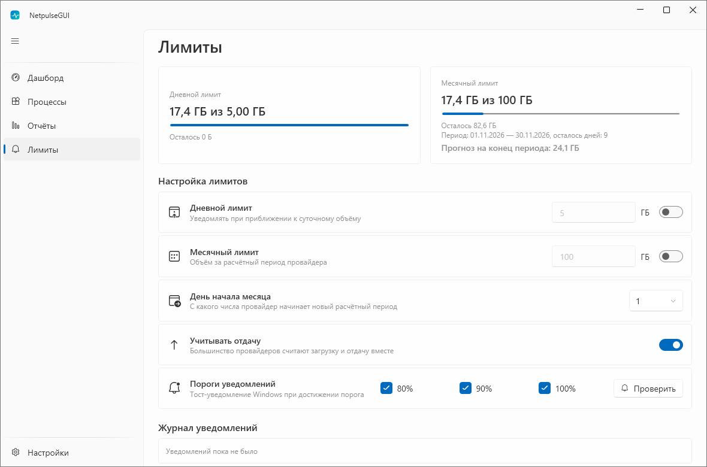

<p align="center">
  
</p>

<h1 align="center">NetpulseGUI</h1>

<p align="center">
  Монитор сетевого трафика для Windows 10/11 в стиле Windows 11 Fluent.<br>
  Скорость прямо в иконке трея · учёт по адаптерам и по процессам (ETW) · отчёты CSV/XLSX · лимиты с уведомлениями
</p>

<p align="center">
  <a href="../../releases/latest"></a>
  
  
  
</p>



| Процессы | Отчёты |
|---|---|
|  |  |
| **Лимиты** | **Настройки** |
|  |  |

> Скриншоты сняты при запуске без прав администратора: живая скорость по процессам в этом режиме недоступна, а объёмы за период взяты из ранее собранной статистики.

## Скачать

На странице [последнего релиза](../../releases/latest) два варианта:

| Файл | Что это |
|---|---|
| `NetpulseGUI-<версия>-setup.exe` | Установщик: Program Files, ярлыки, автозапуск по желанию, корректное удаление |
| `NetpulseGUI.exe` | Портативная версия: один файл, .NET устанавливать не нужно |

При запуске Windows попросит права администратора — они нужны для учёта трафика по процессам. Exe не подписан, поэтому SmartScreen может показать предупреждение: «Подробнее» → «Выполнить в любом случае».

*English: NetpulseGUI is a Fluent-style network traffic monitor for Windows 10/11 — live speed in the tray icon, per-adapter and per-process (ETW) accounting, reports with CSV/XLSX export, daily/monthly limits with toast alerts. The UI is in Russian by default; switch to English in Settings → Language.*

## Возможности

- **Дашборд** — карточки «Загрузка / Отдача» с текущей скоростью и пиком за сеанс, живой график за 60 сек / 5 мин / 1 час, итоги «Сегодня / Этот месяц / Всего» с прогнозом на конец расчётного периода, топ-5 процессов прямо сейчас.
- **Процессы** — таблица с иконками, текущей скоростью ↓↑, объёмом за период (сегодня, вчера, 7 дней, месяц, всё время), спарклайном активности за 60 сек, сортировкой и поиском. Процессы с одинаковым exe объединяются. Двойной клик (или Enter) открывает страницу процесса с живым графиком и историей за 1 ч / 24 ч / 7 дн / 30 дн.
- **Отчёты** — день, неделя, месяц (расчётный период) или произвольный интервал; столбцы по часам или по дням, кольцевая диаграмма по процессам, топ процессов, сравнение с прошлым периодом в %, среднее и пик. Экспорт в **CSV** и **XLSX** (ClosedXML: листы «Сводка», «По дням/часам», «Процессы» с таблицами и итогами).
- **Лимиты** — дневной и месячный лимиты, день начала месяца как у провайдера, учитывать ли отдачу, тост-уведомления Windows на 80/90/100% (каждый порог один раз за сутки или период, состояние переживает перезапуск), журнал уведомлений.
- **Настройки** — запуск с Windows (задача Планировщика), сворачивание в трей при закрытии, запуск свёрнутым, тема (как в системе / светлая / тёмная), язык (русский по умолчанию / английский, переключается без перезапуска), единицы (бит/с или байт/с), частота обновления интерфейса, исключённые адаптеры и виртуальные/VPN-адаптеры, резервная копия и восстановление БД, сброс статистики (перед сбросом автоматически делается копия).
- **Трей** — иконка сама рисует две строки скорости (↓ сверху, ↑ снизу), размер берётся под DPI основного монитора, цвета — под светлую/тёмную панель задач, обновление раз в секунду. Каждый HICON освобождается через `DestroyIcon`. Тултип показывает скорость и трафик за сегодня и месяц. Левый клик — Fluent-окошко (Acrylic) над треем с мини-графиком, итогами и топ-3; правый клик — меню «Открыть / Пауза / Отчёт за сегодня / Настройки / Выход».

### Что добавлено сверх ТЗ

- Прогноз расхода до конца расчётного периода (на дашборде и в лимитах, подсвечивается красным, если прогноз превышает лимит).
- Пиковая скорость за сеанс.
- Быстрый сбор счётчиков через `GetIfTable2`: один вызов WinAPI на тик вместо `GetAllNetworkInterfaces()` (~40 мс → ~1 мс), фоновая нагрузка упала в 3 раза.
- Итоги учитывают ещё не записанный буфер, поэтому цифры не «прыгают» в момент записи в БД.
- Автоматическая резервная копия перед сбросом статистики.
- Аргумент `--page=dashboard|processes|reports|limits|settings` открывает нужную страницу (удобно для ярлыков).
- `NetpulseGUI.exe --shutdown` штатно завершает запущенный экземпляр: буфер записывается в БД, ETW-сессия останавливается. Работает и из процесса без прав администратора, его использует установщик при удалении.
- Полный путь к exe берётся из ETW-события загрузки образа, поэтому учитываются и процессы, которые живут доли секунды (curl, установщики): к моменту доставки ETW-события их уже нет.
- Если exe перенесли, путь в задаче автозапуска исправляется при следующем запуске.
- При обновлении с ранних сборок под именем NetPulse данные из `%LOCALAPPDATA%\NetPulse` переносятся автоматически, старая задача автозапуска заменяется новой.

## Сборка и запуск

Требования: Windows 10 1809+ / 11 x64 и .NET SDK 9 (или новее: SDK 10 тоже собирает проект под net9).

```powershell
dotnet build
```

```powershell
dotnet test
```

```powershell
dotnet run --project src/NetpulseGUI
```

Приложение требует прав администратора (`requireAdministrator` в манифесте), поэтому при запуске появится запрос UAC.

### Портативная сборка (один exe)

```powershell
dotnet publish src/NetpulseGUI -c Release -r win-x64 --self-contained -p:PublishSingleFile=true -o artifacts/publish
```

Результат — `artifacts/publish/NetpulseGUI.exe` (~80 МБ, .NET устанавливать не нужно).

### Всё сразу: тесты, exe и установщик

```powershell
.\build.ps1
```

Если установлен [Inno Setup 6](https://jrsoftware.org/isinfo.php), в `artifacts/` появится `NetpulseGUI-<версия>-setup.exe`. Установщик кладёт exe в Program Files, создаёт ярлыки, по желанию включает автозапуск, а при удалении снимает задачу автозапуска, останавливает ETW-сессию и предлагает удалить данные.

Сборку под другой TFM можно сделать так: `dotnet build -p:NetpulseGUINet=net10.0`.

## Права администратора и автозапуск

- Учёт по процессам использует ETW-сессию ядра (провайдер Kernel Network, сессия `NetpulseGUI-Kernel-Network`), а для неё нужны права администратора.
- Чтобы UAC не спрашивал при каждом входе, автозапуск сделан **задачей Планировщика** (NuGet `TaskScheduler`): триггер «при входе пользователя», «выполнять с наивысшими правами», аргумент `--minimized`. Галочка в настройках создаёт или удаляет задачу; менять её можно только из запущенного от администратора NetpulseGUI.
- Если приложение всё же запущено без прав (например, с режимом совместимости `RunAsInvoker`), оно работает в режиме «только адаптеры» и показывает плашку с кнопкой «Перезапустить с правами администратора».
- При старте зависшая ETW-сессия с тем же именем (после аварийного завершения) останавливается; при выходе сессия корректно закрывается.
- Проверено на реальной машине: файл 28,6 МБ, скачанный через curl, учтён у curl.exe как 28,67 МБ (лишнее — заголовки TCP/TLS).

## Архитектура

```
NetpulseGUI.sln
├─ src/NetpulseGUI.Core        — сбор, агрегация, БД (без зависимостей от WPF)
│  ├─ Collection/           AdapterMonitor (дельты, переполнение, пересоздание адаптеров),
│  │                        IfTableCounterSource (GetIfTable2), AdapterClassifier (виртуальные/VPN),
│  │                        AdapterInventory, CollectorEngine (фоновый цикл раз в 1 сек)
│  ├─ Counters/CounterMath  дельта счётчика: 32-битное переполнение / сброс / неправдоподобный скачок
│  ├─ Processes/            ProcessTrafficMonitor (ETW TCP/UDP IPv4/IPv6), ProcessResolver (PID → exe)
│  ├─ Storage/              Database (схема, WAL), TrafficRecorder (пакетная запись во все уровни),
│  │                        TrafficRepository (запросы, бэкап/восстановление), Compactor, CsvExporter
│  ├─ Time/                 TimeBuckets (UTC-бакеты, локальные даты), BillingPeriod (день начала месяца, прогноз)
│  └─ Formatting/           UnitFormatter (бит/с, байт/с, компактный формат для трея)
├─ src/NetpulseGUI             — WPF-приложение (WPF-UI, LiveCharts2, H.NotifyIcon, CommunityToolkit.Mvvm)
│  ├─ AppHost.cs            корень композиции, окна, навигация, события питания и сети
│  ├─ Services/             LiveDataService (история за час, спарклайны), TotalsService, TrayService +
│  │                        TrayIconRenderer, NotificationService, LimitMonitor, AutoStartService,
│  │                        ReportService (отчёты, CSV/XLSX), ThemeService, IconCache, ElevationService
│  ├─ ViewModels/, Views/   MVVM-страницы, всплывающее окно трея
│  ├─ Localization/         Loc (+ разметка {l:Loc Key}), Resources/Strings(.en).resx
│  └─ Settings/             настройки в %LOCALAPPDATA%\NetpulseGUI\settings.json
├─ tests/NetpulseGUI.Tests     — xUnit: счётчики и переполнение, монитор адаптеров, бакеты и периоды,
│                             запись/агрегация/компакция в SQLite, бэкап, разбор GetIfTable2
└─ installer/NetpulseGUI.iss   — Inno Setup
```

**Поток данных.** `CollectorEngine` в собственном фоновом потоке раз в секунду читает счётчики адаптеров и забирает накопленные ETW-байты по процессам → строит `LiveSnapshot` → `LiveDataService` складывает его в кольцевой буфер (1 час) и передаёт в поток UI с заданной частотой. Дельты буферизуются в `TrafficRecorder` и раз в 15 сек одной транзакцией пишутся сразу во все уровни (секунда → минута → час → день). Раз в час `Compactor` удаляет устаревшие детальные уровни, восстанавливает пропущенные часовые бакеты и освобождает место (`incremental_vacuum`).

**Устойчивость.** После сна (`PowerModeChanged.Resume`) и при разрыве между замерами больше 5 минут опорные значения сбрасываются — всплеска не будет. Исчезнувший адаптер забывается, при повторном появлении первый замер считается опорным. Смена DPI или темы панели задач перерисовывает иконку трея. Всплывающее окно позиционируется по рабочей области монитора под курсором с учётом его DPI и положения панели задач. Окно не восстанавливается за пределами отключённого монитора. Если ETW-сессия упала, раз в минуту она перезапускается. При ошибке записи в БД данные возвращаются в буфер.

**Производительность** (Release, окно свёрнуто в трей, 8 ядер, ETW включён): 0,3–1,4% одного ядра (≈0,05–0,2% общего CPU), ~38 МБ приватной памяти, число GDI-объектов стабильно. Пока окно скрыто, график не обновляется, а при показе перестраивается из истории.

## Схема БД

Файл: `%LOCALAPPDATA%\NetpulseGUI\netpulse.db` (SQLite, WAL, `auto_vacuum=INCREMENTAL`). Время (`ts`) — unix-секунды UTC, начало бакета; `day` — локальная дата `yyyy-MM-dd` в часовом поясе системы. `rx` — принято (↓), `tx` — отправлено (↑), в байтах.

| Таблица | Ключ | Хранение | Назначение |
|---|---|---|---|
| `meta` | `key` | — | версия схемы, дата создания |
| `adapters` | `id`, `guid` UNIQUE | — | имя, описание, тип, MAC, first/last seen |
| `traffic_raw` | `(ts, adapter_id)` | 24 часа | посекундный трафик адаптеров |
| `traffic_minute` | `(ts, adapter_id)` | 30 дней | поминутный |
| `traffic_hour` | `(ts, adapter_id)` | бессрочно | почасовой |
| `traffic_day` | `(day, adapter_id)` | бессрочно | по локальным дням (итоги, лимиты, отчёты) |
| `apps` | `id`, `path` UNIQUE NOCASE | — | exe-имя, полный путь (ключ объединения процессов) |
| `app_raw` | `(ts, app_id)` | 24 часа | посекундный трафик приложений |
| `app_minute` | `(ts, app_id)` | 30 дней | поминутный |
| `app_hour` | `(ts, app_id)` | бессрочно | почасовой |
| `app_day` | `(day, app_id)` | бессрочно | по локальным дням |
| `alerts_log` | `id` | — | журнал уведомлений о лимитах |

Все таблицы трафика объявлены `WITHOUT ROWID`. Дельты с нулём байтов не сохраняются.

## Файлы и логи

- `%LOCALAPPDATA%\NetpulseGUI\netpulse.db` — статистика
- `%LOCALAPPDATA%\NetpulseGUI\settings.json` — настройки
- `%LOCALAPPDATA%\NetpulseGUI\logs\netpulse-YYYYMMDD.log` — логи Serilog (14 дней)
- `%LOCALAPPDATA%\NetpulseGUI\backups\` — автокопии перед сбросом статистики
